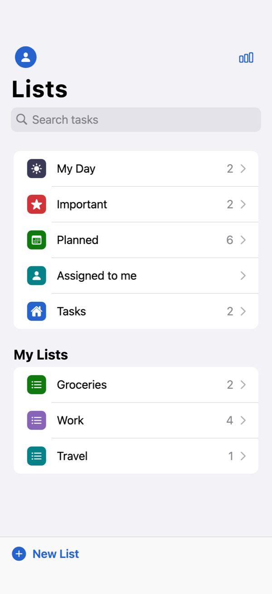
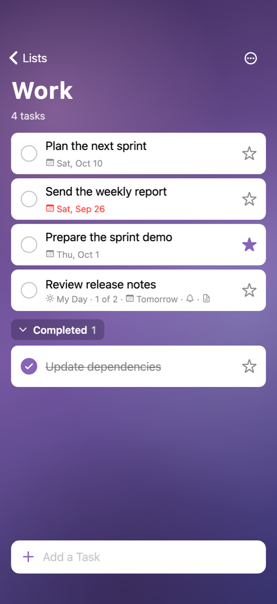
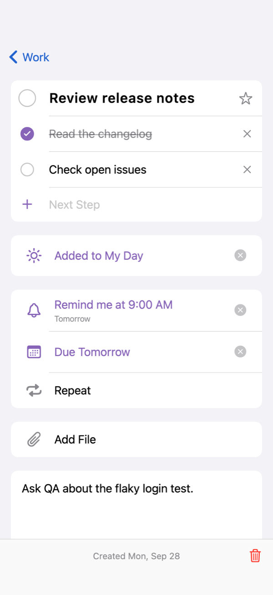
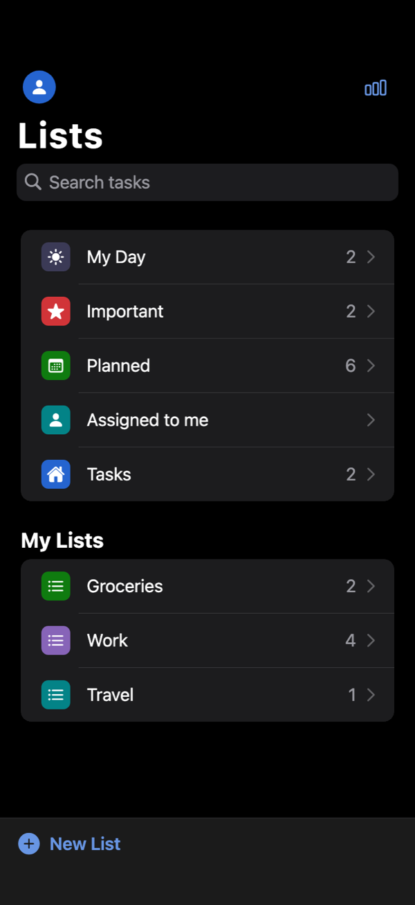
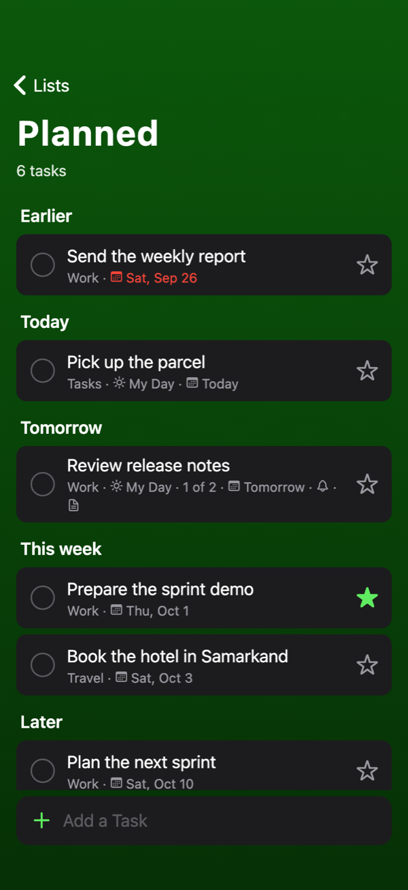
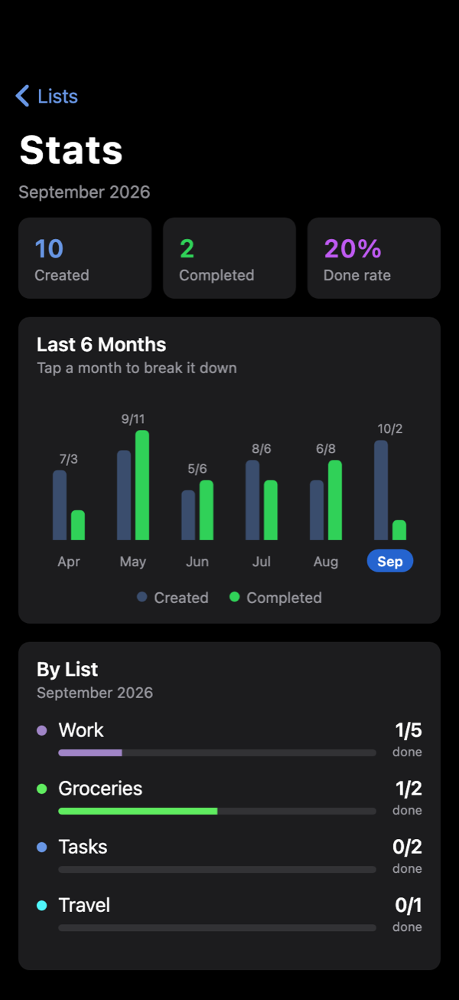

# Kundo

**English** · [O'zbekcha](README.uz.md)

> *Kun* means "day" in Uzbek. Kundo — get your day done.

A to-do app inspired by Microsoft To Do, built with Flutter and designed to feel
at home on iOS. It is local-first: no account, no server, no network — every
list, task and photo stays on your device.

<p align="center">
  
  
  
</p>
<p align="center">
  
  
  
</p>

## Features

- **Smart lists**
  - **My Day** starts fresh every day; *Suggestions* (the light bulb) offers
    open tasks to add to it.
  - **Important** collects starred tasks.
  - **Planned** shows tasks with a due date, grouped into Earlier, Today,
    Tomorrow, This week and Later.
  - **Tasks** holds everything not filed in a list of your own.
  - **Assigned to me** is read-only until sharing exists.
- **Your own lists** — create, rename, pick one of 8 colors, delete (with
  their tasks).
- **Tasks** — complete, star, steps, add to My Day, reminder, due date, repeat,
  note. Swipe left to delete. Finished tasks fold into a *Completed* section.
- **Backgrounds** — five built-in backgrounds (Aurora, Dunes, Peaks, Night,
  Bokeh) or a photo of your own, per list.
- **Search** across task titles and notes.
- **Stats** — tasks created and completed per month over the last six months,
  and a per-list breakdown for the selected month.
- **Appearance** — Automatic, Light or Dark, under Settings.

## Design

Kundo uses the iOS look on every platform:

- large-title navigation bars that stay clear at the top and blur once content
  scrolls under them;
- inset grouped lists, action sheets, alerts and wheel date pickers;
- the iOS search field with its Cancel button on the Lists screen;
- rows that highlight when pressed instead of rippling, SF fonts and
  Cupertino icons;
- `ThemeData.platform = TargetPlatform.iOS`, which brings the back-swipe page
  transition, bouncing scroll and iOS text selection to Android and macOS as well.

Colors come from `AppColors` in [`lib/theme.dart`](lib/theme.dart), a light and a
dark set modeled on UIKit's semantic colors. No screen hard-codes a color. In
dark mode the list backgrounds are dimmed, and list colors are lifted
(`tintFor`) so stars and check marks stay readable on dark cards.

## Getting started

Requires Flutter 3.44 or newer (Dart 3.12).

```bash
git clone https://github.com/RB105/kundo.git
cd kundo
flutter pub get
flutter run
```

Runs on iOS, Android and macOS. Before sending a change:

```bash
flutter analyze
flutter test
```

## Project structure

```
lib/
  main.dart                         entry point, providers, light and dark themes
  theme.dart                        AppColors, IosText, list colors
  models/
    task.dart                       Task, TaskStep, TaskList, RepeatRule
    todo_view.dart                  SmartList and TodoView (anything a list screen shows)
    analytics.dart                  monthly and per-list statistics
    list_background.dart            background kind and how it is stored
  data/
    todo_repository.dart            Hive storage (JSON in a single box)
    background_store.dart           copies picked photos into the app
  cubit/
    todo_cubit.dart                 all task and list state
    appearance_cubit.dart           Automatic / Light / Dark
  screens/
    home_screen.dart                smart lists and your lists
    list_screen.dart                the tasks of one list
    task_detail_screen.dart         a single task
    analytics_screen.dart           Stats
    settings_screen.dart            Settings
  widgets/
    ios_ui.dart                     shared iOS pieces: sheets, action sheets, alerts, date picker
    task_tile.dart                  task card
    quick_sheets.dart               due date, reminder, repeat and theme pickers
    list_actions.dart               rename, re-theme and delete a list
    list_background_view.dart       fits a background to the screen
    background_painters.dart        the built-in painted backgrounds
```

State lives in [`flutter_bloc`](https://pub.dev/packages/flutter_bloc) cubits.
Storage is [`hive`](https://pub.dev/packages/hive) with JSON values, so there is
no code generation step.

## Backgrounds on phones and desktops

A phone is tall (about 9:19.5) and a desktop window is wide (about 16:10), so
one picture can never fit both by scaling.

- Photos are drawn with `BoxFit.cover`: cropped, never stretched.
- The crop is anchored at the top on a tall screen, where faces and horizons
  usually are, and centered on a wide one (`photoAlignmentFor`).
- Photos are decoded at the size they are shown (`decodeWidthFor`), rounded up
  to 256px steps so resizing a desktop window does not re-decode every frame.
- A gradient scrim keeps the white title readable on bright photos, and the
  flat list color shows while a photo decodes.
- The built-in backgrounds are painted with `CustomPainter` from the list
  color, sized from the screen's shortest side. They add nothing to the app
  size and stay sharp at any size.
- A picked photo is copied into the app's own folder, since gallery and file
  dialog paths are temporary. The copy is deleted when the list is deleted or
  gets another background.

## Notes

- The first launch adds demo data: two lists, a few tasks, and five months of
  history so Stats has something to show. Remove `_seed()` in
  [`lib/data/todo_repository.dart`](lib/data/todo_repository.dart) to start
  empty.
- Reminders are stored but do not notify yet;
  [`flutter_local_notifications`](https://pub.dev/packages/flutter_local_notifications)
  would add that.
- *Add file* and *Assigned to me* are placeholders: Kundo keeps no files and
  has no sharing.
- Picking a photo needs `NSPhotoLibraryUsageDescription` on iOS (set in
  `Info.plist`) and the user-selected read-only file entitlement on macOS (set).
  Android uses the system photo picker, which needs no permission.
- `NavBarScrollScope` in [`lib/widgets/ios_ui.dart`](lib/widgets/ios_ui.dart)
  works around a Flutter 3.44 bug in `CupertinoSliverNavigationBar`: swiping
  back while the large title snapped failed Scrollable's `'_hold == null'`
  assertion. [`test/nav_bar_scroll_test.dart`](test/nav_bar_scroll_test.dart)
  covers it.

## License

[MIT](LICENSE).

Kundo is not affiliated with or endorsed by Microsoft. Microsoft To Do is a
trademark of Microsoft Corporation.
