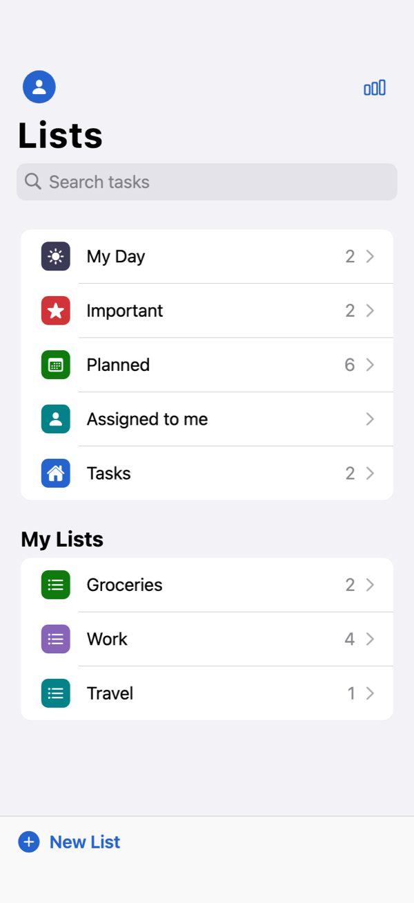
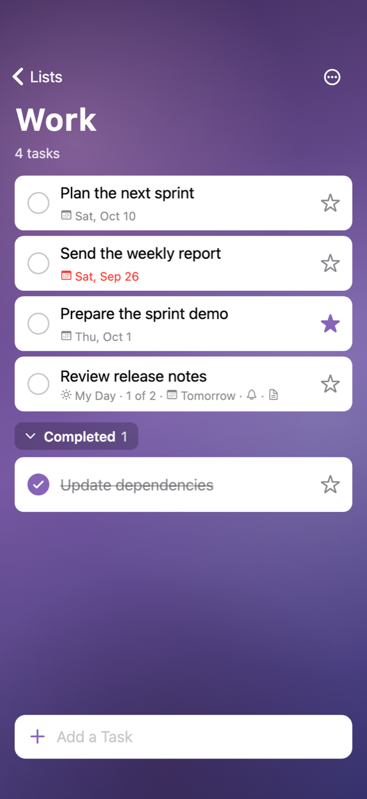
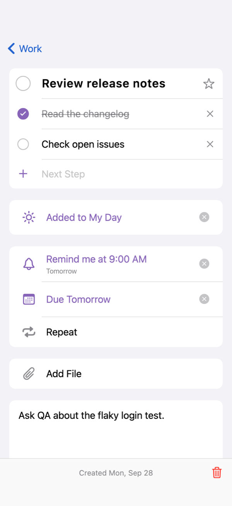
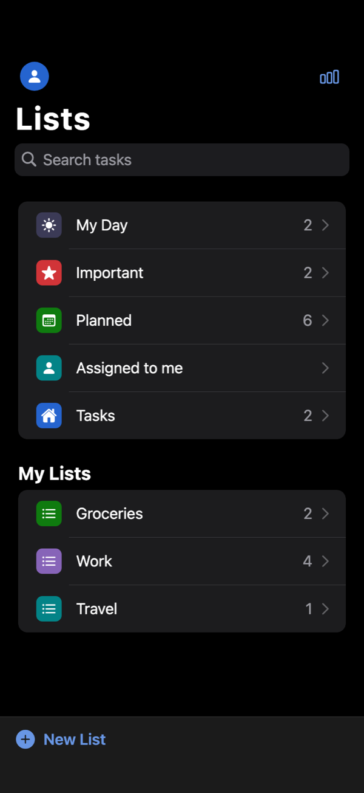
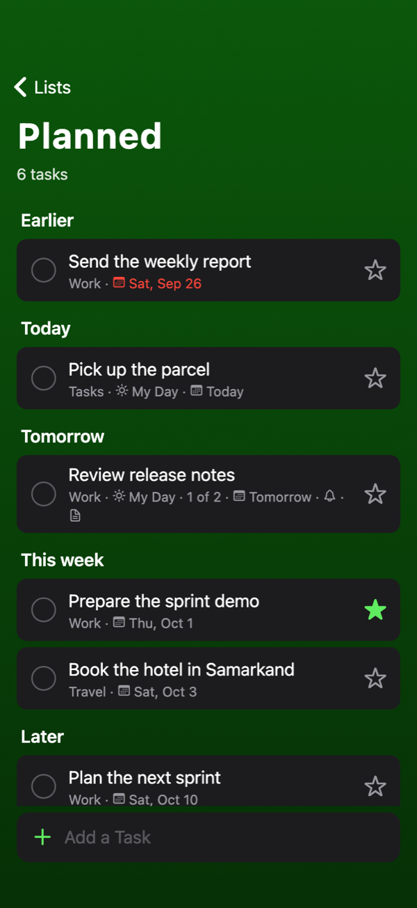
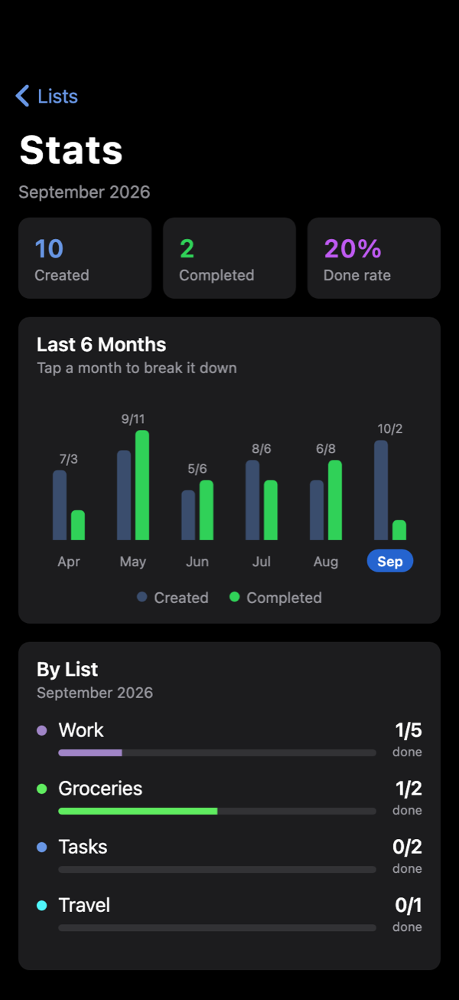

# Kundo

[English](README.md) · **O'zbekcha**

> *Kun* + inglizcha *do* ("qilmoq") — kun ishlarini bitiring.

Microsoft To Do'dan ilhomlangan, iOS ko'rinishidagi vazifalar ilovasi — Flutter'da,
faqat lokal saqlash bilan: akkaunt, server va internet kerak emas.

<p align="center">
  
  
  
</p>
<p align="center">
  
  
  
</p>

## Nima bor

**Smart ro'yxatlar**
- **My Day** — har kuni yangilanadi (kechasi tozalanadi), `Suggestions` (lampochka) tugmasi
  orqali ochiq vazifalarni kunga qo'shish mumkin.
- **Important** — yulduzcha qo'yilgan vazifalar.
- **Planned** — muddati bor vazifalar, `Earlier / Today / Tomorrow / This week / Later`
  sarlavhalari bilan guruhlangan.
- **Assigned to me** — read-only (bo'lishish/akkaunt yo'q, shuning uchun bo'sh).
- **Tasks** — hech qaysi ro'yxatga tegishli bo'lmagan vazifalar.

**Foydalanuvchi ro'yxatlari** — yaratish, nomini o'zgartirish, 8 ta rang mavzusidan
tanlash, o'chirish (ichidagi vazifalari bilan birga).

**Vazifa** — bajarildi belgisi, muhimlik (yulduzcha), steps (kichik qadamlar),
My Day'ga qo'shish, eslatma (reminder), muddat (due date), takrorlanish (repeat),
izoh (note), o'chirish. Tugallanganlar `Completed (n)` bo'limida yig'iladi.

**Fon rasmi** — har bir ro'yxat o'z foniga ega. "Change theme" oynasida rang
bilan birga fon tanlanadi: 5 ta ichki fon (Aurora, Dunes, Peaks, Night, Bokeh)
yoki o'z rasmingiz. Ichki fonlar rasm fayli emas — ro'yxat rangidan kelib chiqib
`CustomPainter` bilan chiziladi, shuning uchun ilova hajmiga ta'sir qilmaydi va
har qanday ekran o'lchamida tiniq chiqadi. Tanlangan rasm ilovaning ichki
papkasiga nusxalanadi (galereya/fayl yo'li vaqtinchalik bo'lgani uchun), ro'yxat
o'chirilganda yoki fon almashtirilganda eski fayl ham o'chiriladi.

**Qidiruv** — sarlavha va izoh bo'yicha.

**Stats (analytics)** — home ekranidagi diagramma tugmasi orqali ochiladi:
oxirgi 6 oy bo'yicha nechta vazifa yaratilgani va nechtasi bajarilgani
(ustunli diagramma, oyni bosib tanlash mumkin), tanlangan oy uchun
`Created / Completed / Done rate` kartochkalari va ro'yxatlar kesimida
taqsimot. Hisob: `created` — `createdAt` shu oyda, `completed` — `completedAt`
shu oyda (qachon yaratilganidan qat'i nazar).

**iOS dizayn** — ilova barcha platformada iOS ko'rinishida: katta sarlavhali
navigatsiya paneli (tepada shaffof, kontent ostiga o'tganda blur), `Lists`
ekranida iOS uslubidagi qidiruv ("Cancel" bilan), inset-grouped ro'yxatlar,
action sheet'lar, `CupertinoAlertDialog`, g'ildirakli sana/vaqt tanlagich,
chapga surib o'chirish, bosilganda highlight (ripple emas), SF shrifti va
CupertinoIcons. `ThemeData.platform = TargetPlatform.iOS` Android va macOS'da
ham iOS o'tish animatsiyasi (orqaga surish), bounce scroll va matn tanlashni beradi.

**Dark theme** — Settings (home'dagi profil tugmasi) → Appearance: `Automatic` (tizimga
ergashadi), `Light`, `Dark`. Tanlov Hive'da saqlanadi. Ranglar `AppColors`
(`lib/theme.dart`) da iOS semantik ranglari bo'yicha yig'ilgan — ekranlar rangni
qattiq kodlamaydi, `AppColors.of(context)` dan oladi. Dark rejimda ro'yxat foni
xiralashtiriladi, ro'yxat rangi esa kartada o'qiladigan bo'lishi uchun
`tintFor()` bilan ochroq qilinadi.

## Arxitektura

```
lib/
  main.dart                       — ilova kirish nuqtasi, BlocProvider
  theme.dart                      — AppColors (light/dark iOS ranglari), IosText, tema
  models/task.dart                — Task, TaskStep, TaskList, RepeatRule
  models/todo_view.dart           — SmartList + TodoView (ekran ko'rsatadigan har qanday ro'yxat)
  models/analytics.dart           — oylik va ro'yxat kesimidagi statistika hisobi
  models/list_background.dart     — fon turi (ichki stil / foydalanuvchi rasmi) va uni saqlash formati
  data/background_store.dart      — rasmni ilova papkasiga nusxalash + platformaga mos picker
  data/todo_repository.dart       — Hive (JSON) orqali lokal saqlash
  cubit/todo_cubit.dart           — barcha holat va biznes-logika
  cubit/appearance_cubit.dart     — Automatic / Light / Dark tanlovi
  screens/home_screen.dart        — ro'yxatlar ro'yxati
  screens/list_screen.dart        — bitta ro'yxat ichidagi vazifalar
  screens/task_detail_screen.dart — vazifa tafsilotlari
  screens/analytics_screen.dart   — Stats ekrani (oylik diagramma + ro'yxatlar kesimi)
  screens/settings_screen.dart    — Settings: Appearance (dark theme)
  widgets/task_tile.dart          — vazifa kartochkasi
  widgets/background_painters.dart— ichki fonlarni chizuvchi painterlar
  widgets/list_background_view.dart— fonni ekran shakliga moslab ko'rsatuvchi widget
  widgets/quick_sheets.dart       — due date / reminder / repeat / theme tanlash sheet'lari
  widgets/ios_ui.dart             — umumiy iOS bloklari: sheet, action sheet, alert, date picker
  widgets/list_actions.dart       — ro'yxatni rename / theme / delete qilish (home va ro'yxat ichidan)
```

State: `flutter_bloc` (Cubit).
Saqlash: `hive` — bitta box ichida JSON, codegen (`build_runner`) kerak emas.

## Rasmlarni mobile va desktopga moslash

Telefon tik (~9:19.5), desktop oynasi yotiq (~16:10) — bitta rasm ikkalasiga
"to'g'ri" sig'maydi, shuning uchun quyidagilar qilingan:

- **`BoxFit.cover`** — rasm hech qachon cho'zilmaydi, faqat kesiladi
  (`fill` deformatsiya qiladi, `contain` chetlarda bo'sh joy qoldiradi).
- **Kesish nuqtasi** — `photoAlignmentFor()`: tik ekranda `topCenter`
  (odam yuzi, ufq odatda yuqori yarmida), keng oynada `center`.
- **`cacheWidth`** — rasm ekranda ko'rinadigan o'lchamda dekodlanadi
  (`decodeWidthFor()`), aks holda 12MP foto telefonda to'liq o'lchamda xotirada
  turadi. Qiymat 256px qadam bilan yaxlitlanadi, shuning uchun desktop oynasini
  sichqoncha bilan cho'zganda har kadrda qayta dekodlash bo'lmaydi.
- **Scrim** — rasm ustiga gradient soya: oq sarlavha yorqin rasmda ham o'qiladi.
- **Pastda tekis rang** — rasm dekodlanguncha ro'yxat oq "chaqnamaydi".
- **Ichki fonlar** — barcha o'lchamlar `size` ning ulushi sifatida hisoblanadi
  (`shortestSide`), shuning uchun tik va yotiq ekranda proportsiya buzilmaydi.
- **Agar kelajakda haqiqiy rasm assetlari qo'shilsa**: `assets/bg/foo.jpg` bilan
  birga `assets/bg/2.0x/foo.jpg` va `3.0x/` variantlarini qo'ying — Flutter
  qurilma DPR'iga qarab o'zi tanlaydi; telefon uchun ~1600px, desktop uchun
  ~2560px kenglik va WebP format yetarli.

## Ishga tushirish

Flutter 3.44+ (Dart 3.12) kerak.

```bash
git clone https://github.com/RB105/kundo.git
cd kundo
flutter pub get
flutter run
```

Testlar: `flutter analyze && flutter test`.

## Eslatmalar

- Birinchi ishga tushishda demo ma'lumot qo'shiladi (Groceries, Work ro'yxatlari,
  bir nechta joriy vazifa va Stats ekrani bo'sh ko'rinmasligi uchun oxirgi 5 oylik
  tarix). Kerak bo'lmasa `lib/data/todo_repository.dart` dagi `_seed()`
  ni o'chirib tashlang.
- Reminder faqat saqlanadi — haqiqiy local notification ulanmagan
  (`flutter_local_notifications` qo'shilsa ishlaydi).
- Fon rasmi uchun platforma sozlamalari qo'shilgan: iOS `NSPhotoLibraryUsageDescription`
  (Info.plist), macOS `com.apple.security.files.user-selected.read-only`
  (entitlements). Android'da qo'shimcha ruxsat kerak emas — tizim Photo Picker
  ishlatiladi.
- "Add file" va "Assigned to me" hozircha faol emas — ilova hamma narsani faqat
  qurilmada saqlaydi, fayl saqlash va bo'lishish yo'q.
- `NavBarScrollScope` (`lib/widgets/ios_ui.dart`) — Flutter 3.44'dagi
  `CupertinoSliverNavigationBar` xatosini aylanib o'tadi: katta sarlavha snap
  bo'layotganda orqaga surilsa `'_hold == null'` assertion chiqardi
  (`test/nav_bar_scroll_test.dart`).

## Litsenziya

[MIT](LICENSE). Kundo Microsoft bilan bog'liq emas va Microsoft tomonidan
qo'llab-quvvatlanmaydi; "Microsoft To Do" — Microsoft Corporation'ning savdo belgisi.
